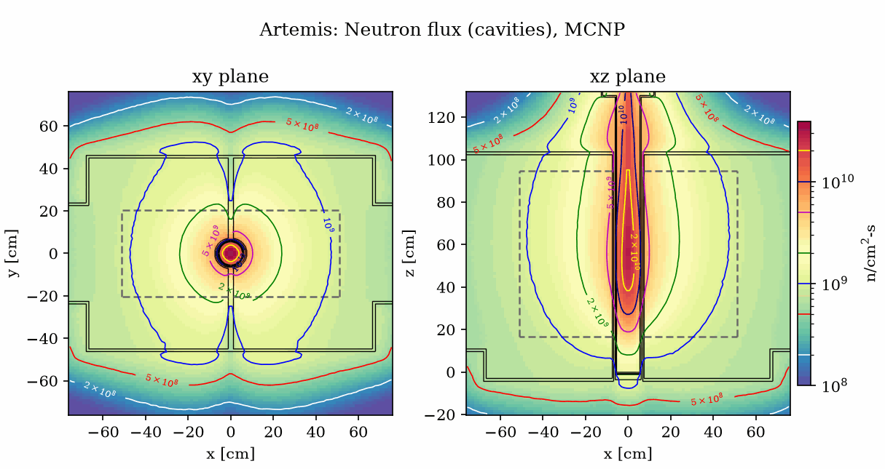
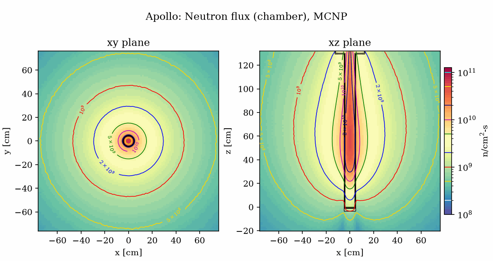

# shine-neutron-source

Neutron sources and simplified models of SHINE's neutron generators, for MCNP and OpenMC, with the
neutron and photon fields they give where parts are irradiated. Each source is made with
[beam-target](https://github.com/lucasjacobson/beam-target); each system's MCNP and OpenMC models
match number for number, and all are ready to run.

## Systems

| System | | Neutron yield | Peak neutron flux | Peak 1-MeV(Si) equivalent flux | |
|---|---|---|---|---|---|
| **Artemis** | SHINE Radiation Effects | 1.75 × 10¹³ n/s | 6.79 × 10⁹ n/cm²-s | 1.08 × 10¹⁰ n/cm²-s | [Details](docs/artemis.md) |
| **Apollo** | UKAEA | 3.11 × 10¹³ n/s | 2.09 × 10¹⁰ n/cm²-s | 3.70 × 10¹⁰ n/cm²-s | [Details](docs/apollo.md) |

Both are DT generators: a 280 keV, 45 mA deuteron beam travels down a 137 cm chamber of deuterium
and tritium gas. The yields are each system's operating level for its use. The fluxes are from
MCNP; OpenMC agrees within 0.6% for neutrons (see [Methods](docs/methods.md)).

### Artemis

Artemis, SHINE's neutron generator for SHINE Radiation Effects, sits in a water pit below ground,
with an irradiation cavity on each side of its chamber. Parts go in a cassette in each cavity. Its
peak is on a 5 × 5 × 0.1 cm plate as close to the chamber as a part in the cassette can get.

<p align="center"></p>

### Apollo

Apollo, SHINE's neutron generator for UKAEA (the UK Atomic Energy Authority), hangs from the
ceiling slab of its irradiation room, with parts placed around it. Its peak is in a shell 0.1 cm
thick and 5 cm tall against the chamber's outer wall.

<p align="center"></p>

## Repository layout

Each system has its own files, named after it (`<system>` is `artemis` or `apollo`):

| Path | Contents |
|---|---|
| `source/<system>.toml` | The beam-target input for the source |
| `source/<System>/` | The source, all written by beam-target: `source.sdef` (MCNP), `source.h5` and its reader `openmc_source.py` (OpenMC), `summary.toml`, and `plots/` |
| `mcnp/<system>/<system>.i` | The MCNP model |
| `mcnp/<system>/plot_*` | MCNP geometry plot commands; the flux maps cover the same windows |
| `openmc/<system>/<system>.py` | The OpenMC model, the same as the MCNP model |
| `images/<system>/` | Geometry plots (in the repository) and result plots (made locally) |
| `data/silicon_*.txt` | Responses in silicon for the OpenMC tallies, from the MCNP data |
| `plot_geometry.py` | Geometry plots of both models |
| `plot_results.py` | Spectra, maps, and tables from either code or both |
| `docs/` | Each system's details, the shared methods, and the figures they show |

## Quick start

**Requirements**

- MCNP: MCNP 6.3 with the ENDF/B-VIII.1 ACE libraries (Lib81, ENDF81SaB, and eprdata25).
- OpenMC: OpenMC 0.16 or later with an ENDF/B-VIII.1 library. Each source is read with the
  `openmc_source.py` that beam-target writes with it, so beam-target itself is needed only to
  remake a source.
- Plots: Python 3.12 or later with numpy, h5py, matplotlib, and Pillow; mcnptools (it comes with
  MCNP) to read MCNP results; and Ghostscript for the MCNP geometry plots.

**Run the models** (10⁸ histories each, about 1.6 to 1.8 hours per code on 32 cores):

```bash
# MCNP, from mcnp/<system>/ (remove the <system>.i* outputs of an earlier run first)
cd mcnp/artemis
mcnp6 n=artemis.i tasks 14

# OpenMC, from anywhere (it writes its files in openmc/<system>/)
export OPENMC_CROSS_SECTIONS=/path/to/endfb-viii.1/cross_sections.xml
python openmc/artemis/artemis.py --threads 14
```

The MCNP runs write a restart dump every 10⁷ histories, and the OpenMC runs a statepoint after
every batch (10⁷ histories); `--restart` continues an OpenMC run from its latest statepoint.

**Make the plots and tables**, from the top of the repository:

```bash
python plot_results.py            # every system, both codes; --system, --mcnp, --openmc to choose
python plot_geometry.py           # geometry plots of both models of every system
```

`plot_results.py` skips a code whose results are missing, writes about 25 plots per system and
code to `images/<system>/`, and prints each system's tables.

**Remake a source** with `beam-target source/<system>.toml -o source`. A new source changes the
neutron yield, which the MCNP model's `fm` cards and `factor` keywords hold (see
[Units and normalization](docs/methods.md#units-and-normalization)).

## Documentation

- [Artemis](docs/artemis.md): the model, the source, and the full results.
- [Apollo](docs/apollo.md): the model, the source, and the full results.
- [Methods](docs/methods.md): the tally numbering, the responses in silicon, units and
  normalization, how MCNP and OpenMC compare, and the limitations of the models.

## License

MIT; see [LICENSE](LICENSE). Each `source/<System>/openmc_source.py` is beam-target's code, under
its own MIT notice, which must stay with the file. The tables in `data/` are derived from Los Alamos
National Laboratory's Lib81 and eprdata25 ACE libraries, as their headers say; they are not a
product of, or endorsed by, Los Alamos National Laboratory.
