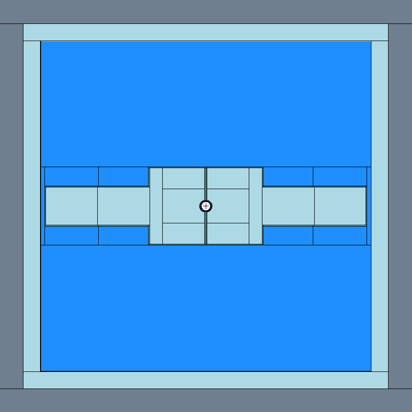
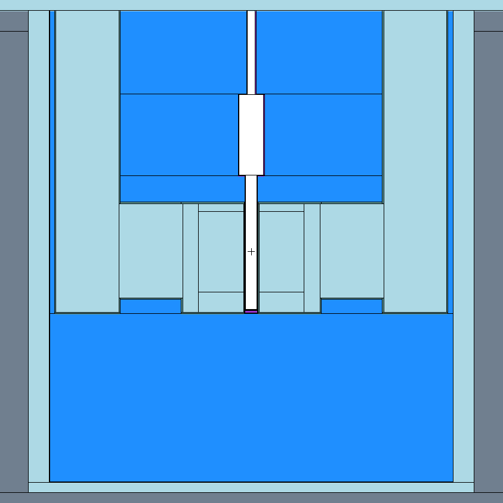
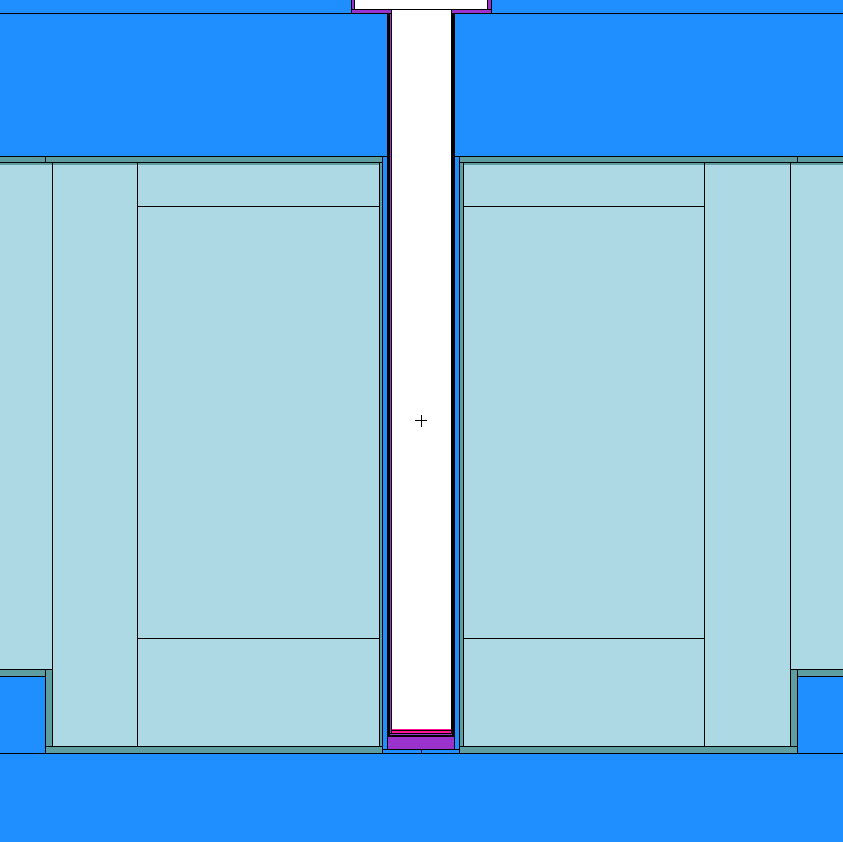
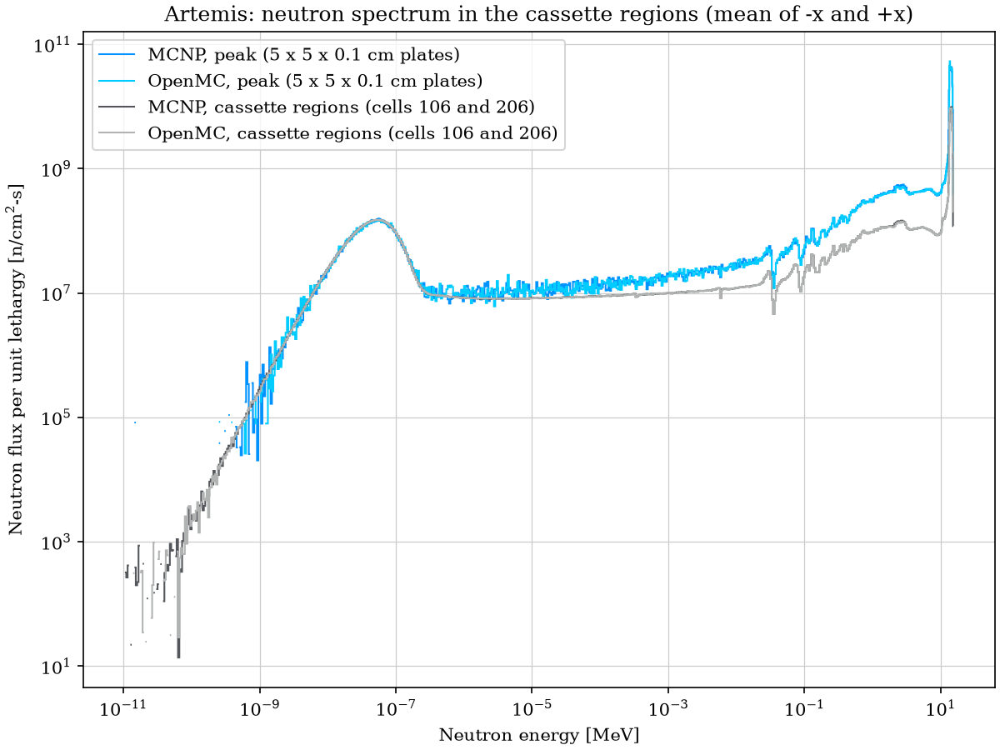
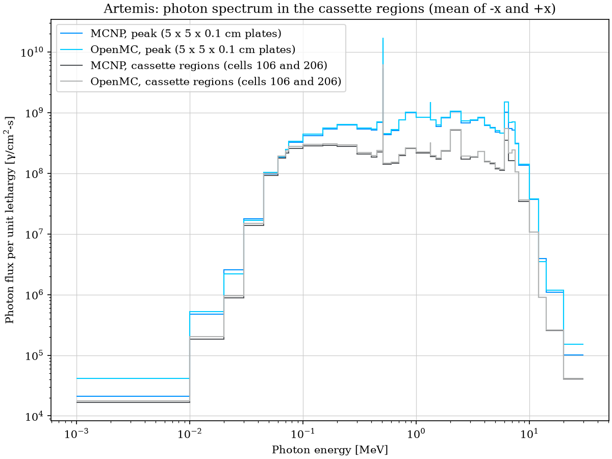
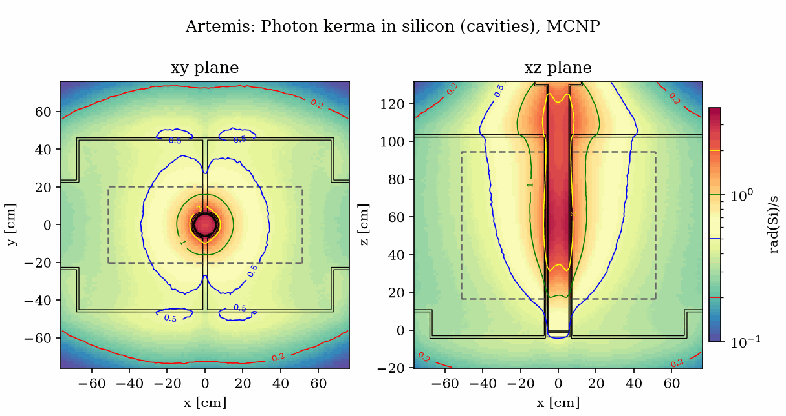

# shine-neutron-source

The neutron source and a simplified model of Artemis, a DT neutron generator at SHINE, for MCNP
and OpenMC, with the neutron and photon fields they give in its irradiation cavities. The source
is made with [beam-target](https://github.com/lucasjacobson/beam-target); the two models match
number for number, and both are ready to run.

## Contents

- [Artemis](#artemis)
- [Repository layout](#repository-layout)
- [Quick start](#quick-start)
- [The model](#the-model)
- [The source](#the-source)
- [Results](#results)
- [Units and normalization](#units-and-normalization)
- [Limitations](#limitations)
- [License](#license)

## Artemis

Artemis makes neutrons with a 280 keV, 45 mA deuteron beam (12.6 kW) traveling down a 137 cm
target chamber of deuterium-tritium gas (50% D₂, 50% T₂). The chamber sits in a water pit below
ground, with an irradiation cavity on each side of it. Parts to be irradiated go in a cassette in
each cavity, as close to the chamber as the cavity wall allows.

## Repository layout

| Path | Contents |
|---|---|
| `source/artemis.toml` | The beam-target input for the source |
| `source/Artemis/` | The source, all written by beam-target: `source.sdef` (MCNP), `source.h5` and its reader `openmc_source.py` (OpenMC), `summary.toml`, and `plots/` |
| `mcnp/artemis.i` | The MCNP model |
| `mcnp/plot_*` | MCNP geometry plot commands; the flux maps cover the same windows |
| `openmc/artemis.py` | The OpenMC model, the same as the MCNP model |
| `data/silicon_*.txt` | Responses in silicon for the OpenMC tallies, from the MCNP data (see [Responses in silicon](#responses-in-silicon)) |
| `plot_geometry.py` | Geometry plots of both models |
| `plot_results.py` | Spectra, maps, and tables from either code or both |
| `images/` | Geometry plots (in the repository) and result plots (made locally) |
| `docs/figures/` | The result figures in this README |

## Quick start

**Requirements**

- MCNP: MCNP 6.3 with the ENDF/B-VIII.1 ACE libraries (Lib81, ENDF81SaB, and eprdata25).
- OpenMC: OpenMC 0.16 or later with an ENDF/B-VIII.1 library. The source is read with
  `source/Artemis/openmc_source.py`, which beam-target writes with it, so beam-target itself is
  needed only to remake the source.
- Plots: Python 3.12 or later with numpy, h5py, matplotlib, and Pillow; mcnptools (it comes
  with MCNP) to read MCNP results; and Ghostscript for the MCNP geometry plots.

**Run the models** (10⁸ histories each, about 1.6 hours on 32 cores):

```bash
# MCNP, from mcnp/ (remove the artemis.i* outputs of an earlier run first)
cd mcnp
mcnp6 n=artemis.i tasks 14

# OpenMC, from anywhere (it writes its files in openmc/)
export OPENMC_CROSS_SECTIONS=/path/to/endfb-viii.1/cross_sections.xml
python openmc/artemis.py --threads 14
```

The MCNP run writes a restart dump every 10⁷ histories, and the OpenMC run a statepoint after
every batch (10⁷ histories); `python openmc/artemis.py --restart` continues an OpenMC run from
its latest statepoint.

**Make the plots and tables**, from the top of the repository:

```bash
python plot_results.py            # both codes; --mcnp or --openmc for one
python plot_geometry.py           # geometry plots of both models
```

`plot_results.py` writes about 25 plots per code to `images/` and prints the tables in
[Results](#results).

**Remake the source** with `beam-target source/artemis.toml -o source`. A new source changes the
neutron yield, which the MCNP model's `fm` cards and `factor` keywords hold (see
[Units and normalization](#units-and-normalization)).

## The model

A very simplified model of Artemis below ground:

- the target chamber, with its double steel wall and cooling water, and the beam stop at its
  bottom;
- the upstream section of the beamline, with the beam tube up to the ground;
- the two irradiation cavities (aluminum), each with its cassette region and its duct up to the
  ground, and the water and aluminum wall between the chamber and each cavity (their cylinders
  centered 0.48 cm toward the cavity, as in the design);
- the water pit, full of water up to the ground, its steel liner, and an air gap;
- the concrete pit walls, floor, and slab; 3 ft of earth around them; and air above ground.

The model is symmetric about x = 0 and y = 0. The backstop is at the origin, the beam travels
down (−z), and the ground is at z = 289.56 cm. Every cell is a plain intersection of
half-spaces, so the model is easy to read and runs fast.

<p align="center">


</p>
<p align="center">


</p>

**The cassette regions** (cells 106 and 206) are the space available for parts: a box 49.9 cm
long (along x), 40.6 cm wide, and 78.1 cm high (z = 16.5 to 94.6 cm), outside the cavity wall
around the chamber. Each holds 153.2 liters of air. The maps outline their open sides with dashed
gray lines.

**Materials** come from PNNL's *Compendium of Material Composition Data for Radiation Transport
Modeling*, with ENDF/B-VIII.1 data: air, aluminum 6061-O, Portland concrete, copper, U.S. average
earth, stainless steel 304, and water, with thermal scattering data for aluminum, iron, and
hydrogen in water.

**Tallies** (the same numbers in both models):

| Tallies | What |
|---|---|
| 14, 24 | Neutron spectrum (CCFE-709 groups) and photon spectrum (VITAMIN-J-42) in the cassette regions |
| 34, 44, 54 | 1-MeV(Si) equivalent neutron flux, neutron kerma in silicon, and photon kerma in silicon, in the cassette regions |
| 64 to 254 | Maps of the neutron flux (in four energy groups), the photon flux, the 1-MeV(Si) equivalent flux, and the neutron and photon kerma in silicon, in each plot window |
| 264 to 374 | The same at the peak flux in each cassette region, on a 5 × 5 cm plate, 0.1 cm thick, 7.8 to 7.9 cm from the beam axis (about as close as a part in the cassette can get), at the height of the peak flux (z = 55.88 cm) |

The neutron energy groups of the maps are below 0.5 eV, 0.5 eV to 0.1 MeV, 0.1 to 10 MeV, and
above 10 MeV.

## The source

The source comes from [beam-target](https://github.com/lucasjacobson/beam-target), which follows
the deuteron beam down the chamber as it slows down and spreads, and calculates the neutrons it
makes at each position, angle, and energy. The gas density is solved so that the beam reaches the
backstop with 10 keV.

| | |
|---|---|
| Beam | Deuterons, 280 keV, 45 mA, 0.4 cm diameter at entry, 36 mrad divergence |
| Target | D₂/T₂ gas (50/50), 137 cm long, 10.90 cm (4.29 in) inner diameter, 1.47 × 10⁻⁶ g/cm³ (solved) |
| Stopping powers | ICRU Report 49 |
| Cross sections | DROSG-2000: T(d,n)⁴He and D(d,n)³He |
| Neutron yield | 1.749 × 10¹³ n/s: 99.0% DT, 1.0% DD |
| Mean neutron energy | 14.00 MeV |

<p align="center">


</p>

**MCNP and OpenMC sources.** The OpenMC source (`source.h5`) keeps the full correlation between
position, angle, and energy. An MCNP SDEF distribution can depend on only one other variable, so
in `source.sdef` the neutron energy depends on the emission angle but not on the position along
the chamber. The full summary is in [`source/Artemis/summary.toml`](source/Artemis/summary.toml).

## Results

All results are per second at the full yield. "Peak" is on the 5 × 5 × 0.1 cm plate at the
peak flux; "cassette" is the mean over a cassette region (cell 106 or 206). The two cassette
regions agree within statistics, so each value is the mean of the two. The relative errors
(one standard deviation) are statistical; for the total kerma and the two ratios they are
combined as if independent, which overstates them for the ratios.

| | Peak, MCNP | Peak, OpenMC | Cassette, MCNP | Cassette, OpenMC |
|---|---|---|---|---|
| Neutron flux [n/cm²-s] | 6.79 × 10⁹ (0.10%) | 6.80 × 10⁹ (0.11%) | 1.77 × 10⁹ (0.01%) | 1.77 × 10⁹ (0.01%) |
| Neutron flux above 10 MeV [n/cm²-s] | 4.92 × 10⁹ (0.11%) | 4.95 × 10⁹ (0.11%) | 9.80 × 10⁸ (0.01%) | 9.86 × 10⁸ (0.01%) |
| 1-MeV(Si) equivalent flux [n/cm²-s] | 1.08 × 10¹⁰ (0.10%) | 1.09 × 10¹⁰ (0.11%) | 2.27 × 10⁹ (0.01%) | 2.28 × 10⁹ (0.01%) |
| Neutron kerma in silicon [rad(Si)/s] | 6.28 (0.10%) | 6.32 (0.11%) | 1.27 (0.01%) | 1.27 (0.01%) |
| Photon kerma in silicon [rad(Si)/s] | 1.99 (0.25%) | 2.15 (0.27%) | 0.621 (0.02%) | 0.688 (0.02%) |
| Total kerma in silicon [rad(Si)/s] | 8.27 (0.10%) | 8.48 (0.11%) | 1.89 (0.01%) | 1.96 (0.01%) |
| Hardness factor (1-MeV(Si) equivalent / total) | 1.60 (0.14%) | 1.60 (0.16%) | 1.28 (0.02%) | 1.29 (0.02%) |
| Fraction of the neutron flux above 10 MeV | 0.724 (0.14%) | 0.728 (0.16%) | 0.554 (0.02%) | 0.556 (0.02%) |

### Spectra

<p align="center">


</p>

### Maps

In the cavities, from MCNP: the neutron flux, the neutron flux above 10 MeV, the 1-MeV(Si)
equivalent neutron flux, the fraction of the neutron flux above 10 MeV, and the photon kerma in
silicon.

<p align="center"></p>
<p align="center"></p>
<p align="center"></p>
<p align="center"></p>
<p align="center"></p>

`plot_results.py` also maps the neutron flux in the other energy groups, the photon flux, the
neutron and total kerma, and the hardness factor, for both codes, in the cavities and over the
whole pit.

### Responses in silicon

- **1-MeV(Si) equivalent neutron flux:** the neutron flux weighted by silicon's displacement
  damage, the damage energy cross section (MT 444) of ENDF/B-VIII.1 silicon, over the 1 MeV
  reference of 95 MeV-mb. This is the ENDF/B-VIII.1 damage function, not the ASTM E722 table,
  which is based on older data.
- **Kerma in silicon:** the energy given to charged particles in a small piece of silicon, from
  the heating cross sections of ENDF/B-VIII.1 silicon (neutrons, from Lib81) and of eprdata25
  (photons), in rad(Si)/s. It equals the absorbed dose where there is charged-particle
  equilibrium, as in a device within a few millimeters of material.

MCNP tallies these with `fm` cards on a silicon material that is in no cell. OpenMC tallies them
with energy-function filters from [`data/silicon_*.txt`](data/), which hold the same data, taken
from the same MCNP ACE files, so the two codes use the same responses.

### MCNP and OpenMC

The neutron results agree within 0.7% (the statistical errors are 0.1% or less). The photon flux
is 5 to 7% higher in OpenMC, and the photon kerma 8 to 11% higher, so the total kerma is 2 to 4%
higher; with the same response data in both codes, the difference is in the photon production or
transport, and is not yet explained.

## Units and normalization

Fluxes are per cm² per second and kerma is in rad(Si) per second, at the full neutron yield of
1.748845 × 10¹³ n/s.

- **MCNP** tallies are per source neutron; the model multiplies them by the yield with `fm` cards
  (cell tallies) and the `factor` keyword (mesh tallies). If the source changes, change the yield
  in these, including the constants of the silicon cell tallies 34, 44, and 54, which include it.
- **OpenMC** tallies are scaled by the source strength, which beam-target gives in n/s, so they
  are already absolute. Flux tallies are not divided by volume: `plot_results.py` divides the
  cassette tallies by the cells' volumes and the mesh tallies by a mesh element's volume.

## Limitations

- **A simplified model.** It leaves out the accelerator, the internal structure of the beam stop,
  the building above ground, and anything in the cassette regions, which are empty. Parts in a
  cassette change the field around them.
- **The MCNP source** cannot hold the dependence of energy and angle on position (see
  [The source](#the-source)).
- **The photon results** of the two codes differ by up to 11% (see
  [MCNP and OpenMC](#mcnp-and-openmc)).
- **Source assumptions** are beam-target's (straggling neglected, a flat beam profile, and
  others); see its README.

## License

MIT; see [LICENSE](LICENSE). `source/Artemis/openmc_source.py` is beam-target's code, under its
own MIT notice, which must stay with the file. The tables in `data/` are derived from Los Alamos National
Laboratory's Lib81 and eprdata25 ACE libraries, as their headers say; they are not a product of,
or endorsed by, Los Alamos National Laboratory.
