# Apollo

Apollo is SHINE's neutron generator for UKAEA (the UK Atomic Energy Authority). It makes neutrons
with a 280 keV, 45 mA deuteron beam (12.6 kW) traveling down a 137 cm target chamber of
deuterium-tritium gas (10% D₂, 90% T₂). The chamber hangs from the ceiling slab of the main
irradiation room of its bunker, and parts to be irradiated are placed around it.

[Back to the README](../README.md) · [Methods](methods.md) · [Artemis](artemis.md)

## Contents

- [The model](#the-model)
- [The source](#the-source)
- [Results](#results)
- [Limitations](#limitations)

## The model

A very simplified model of Apollo in its bunker, in
[`mcnp/apollo/apollo.i`](../mcnp/apollo/apollo.i) and
[`openmc/apollo/apollo.py`](../openmc/apollo/apollo.py):

- the target chamber, with its double steel wall and cooling water, and the beam stop at its
  bottom, as in Artemis but with a 3.29 in bore;
- the upstream section of the beamline, with the beam tube up to the top of the ceiling slab;
- the main irradiation room (air), 13.6 m long, up to 9.0 m wide, and 4.5 m high, in which the
  chamber hangs with its backstop 3.08 m above the floor; the side irradiation room and the upper
  room above the slab (air);
- the beamline penetration in the ceiling slab: a hole 55 cm across through the bottom 16 cm of
  the slab, and polyethylene pellets (75% of the density of solid polyethylene) around the tubes
  above it;
- the concrete floor, walls, ceiling slab, and roof (Portland concrete), and 3 ft of earth below
  the floor.

The backstop is at the origin and the beam travels down (−z); the floor is at z = −308 cm, and
the ceiling slab runs from z = 146 to 266 cm. Every cell is a plain intersection of half-spaces.

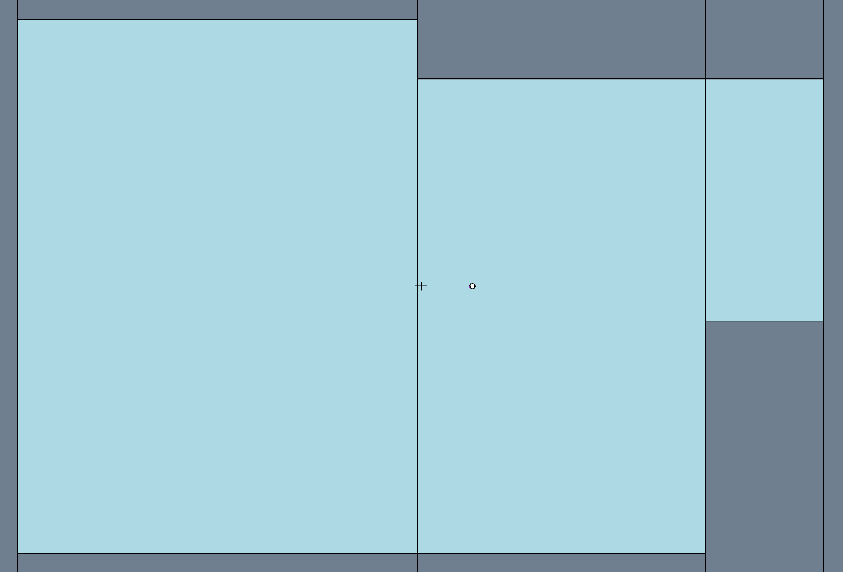

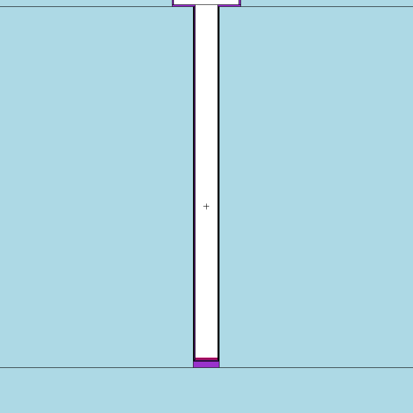

**The peak** is in a cylindrical shell against the chamber's outer wall, from r = 4.9 to 5 cm,
5 cm tall, centered at the height of the peak flux (z = 55.88 cm).

**Materials** come from PNNL's *Compendium of Material Composition Data for Radiation Transport
Modeling*, with ENDF/B-VIII.1 data: air, Portland concrete, copper, U.S. average earth,
polyethylene, stainless steel 304, and water, with thermal scattering data for iron, hydrogen in
polyethylene, and hydrogen in water.

**Tallies** follow the numbering shared by every system (see [Methods](methods.md#tallies)). The
peak tallies are one-bin cylindrical mesh tallies; in MCNP, whose radial bins start at the axis,
the shell is the second radial bin.

| Tallies | What |
|---|---|
| 214 to 264 | At the peak: the neutron flux in four energy groups, the neutron and photon spectra, and the three responses in silicon |
| 4w4 to 8w4 | Maps of each quantity in each plot window w: 1 and 2 for the xy and xz room plots, 4 and 5 for the chamber plots |

## The source

The source comes from [beam-target](https://github.com/lucasjacobson/beam-target), made in the
same way as Artemis's (see [Artemis](artemis.md#the-source)): the gas density is solved so that
the beam reaches the backstop with 10 keV. The input is
[`source/apollo.toml`](../source/apollo.toml), and the full summary is in
[`source/Apollo/summary.toml`](../source/Apollo/summary.toml).

| | |
|---|---|
| Beam | Deuterons, 280 keV, 45 mA, 0.4 cm diameter at entry, 36 mrad divergence |
| Target | D₂/T₂ gas (10/90), 137 cm long, 8.36 cm (3.29 in) inner diameter, 1.71 × 10⁻⁶ g/cm³ (solved) |
| Stopping powers | ICRU Report 49 |
| Cross sections | DROSG-2000: T(d,n)⁴He and D(d,n)³He |
| Neutron yield | 3.114 × 10¹³ n/s: 99.9% DT, 0.1% DD |
| Mean neutron energy | 14.10 MeV |

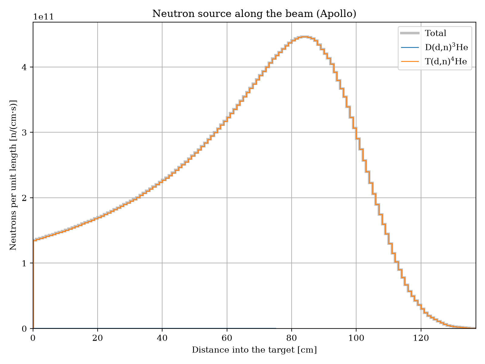
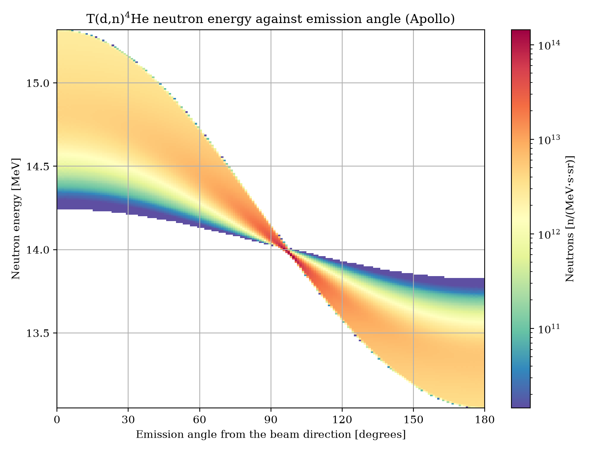

## Results

From 10⁸ histories in each code, per second at the full yield, at the peak: in the shell against
the chamber wall. The values are from MCNP, with their relative errors (one standard deviation,
statistical; for the total kerma and the two ratios they are combined as if independent, which
overstates them for the ratios), and OpenMC's as a ratio to MCNP's.

| At the peak | MCNP | OpenMC/MCNP |
|---|---|---|
| Neutron flux [n/cm²-s] | 2.09 × 10¹⁰ (0.04%) | 1.002 |
| Neutron flux above 10 MeV [n/cm²-s] | 1.80 × 10¹⁰ (0.04%) | 1.003 |
| 1-MeV(Si) equivalent flux [n/cm²-s] | 3.70 × 10¹⁰ (0.04%) | 1.002 |
| Neutron kerma in silicon [rad(Si)/s] | 22.7 (0.04%) | 1.003 |
| Photon kerma in silicon [rad(Si)/s] | 4.12 (0.15%) | 1.020 |
| Total kerma in silicon [rad(Si)/s] | 26.8 (0.04%) | 1.006 |
| Hardness factor (1-MeV(Si) equivalent / total) | 1.76 (0.06%) | 1.000 |
| Fraction of the neutron flux above 10 MeV | 0.860 (0.06%) | 1.001 |

Apollo's peak field is harder than Artemis's (a hardness factor of 1.76 against 1.60, and 86% of
the neutron flux above 10 MeV against 72%): there is no water pit around its chamber to slow the
neutrons down. The photon kerma at the peak is 2% higher in OpenMC, and more across the room; see
[MCNP and OpenMC](methods.md#mcnp-and-openmc).

### Spectra

At the peak.

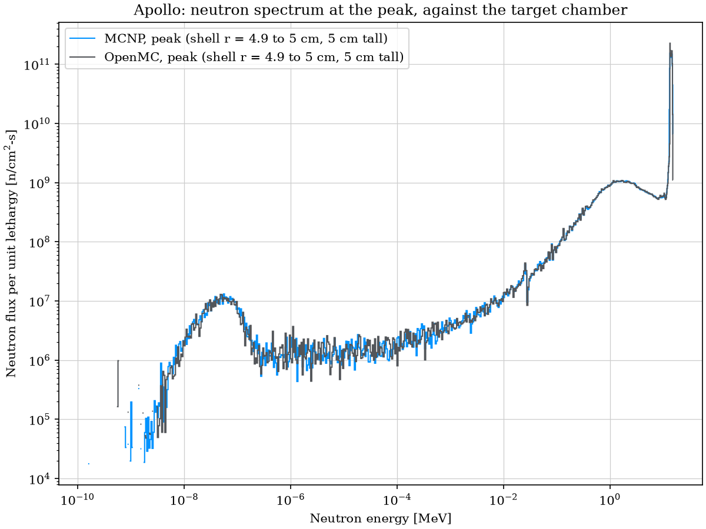
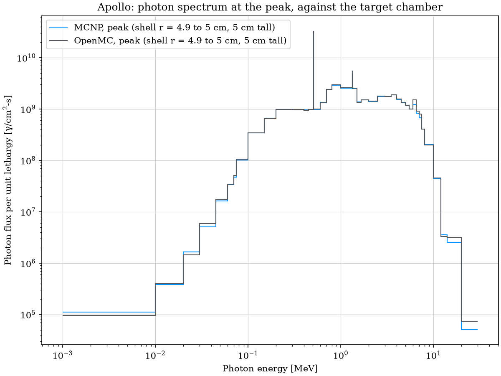

### Maps

Around the chamber, from MCNP: the neutron flux, the neutron flux above 10 MeV, the 1-MeV(Si)
equivalent neutron flux, the fraction of the neutron flux above 10 MeV, and the photon kerma in
silicon.

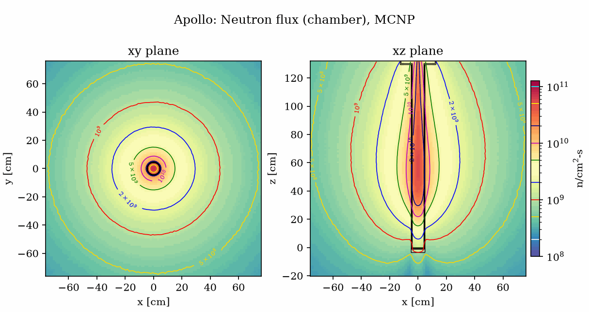

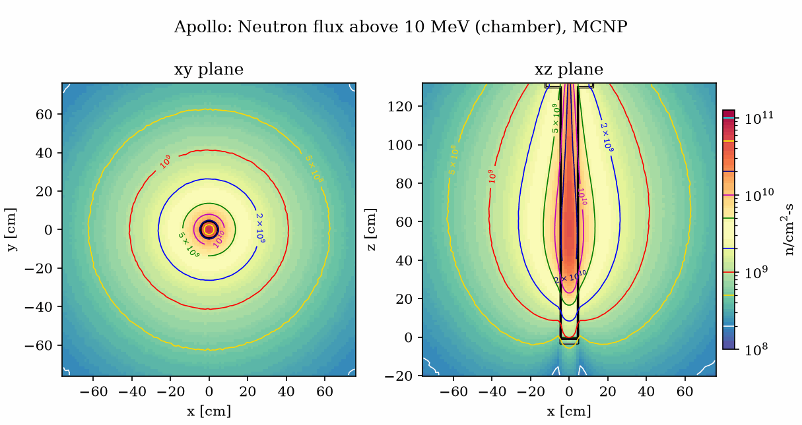

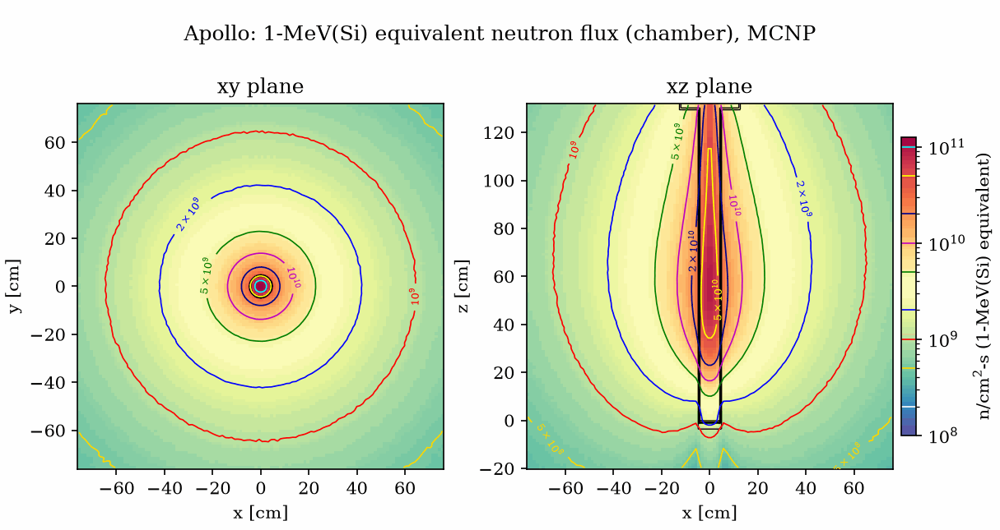

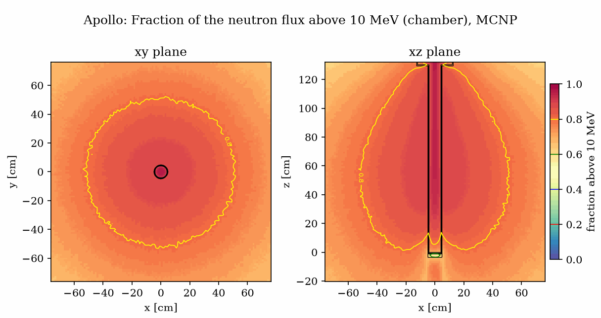

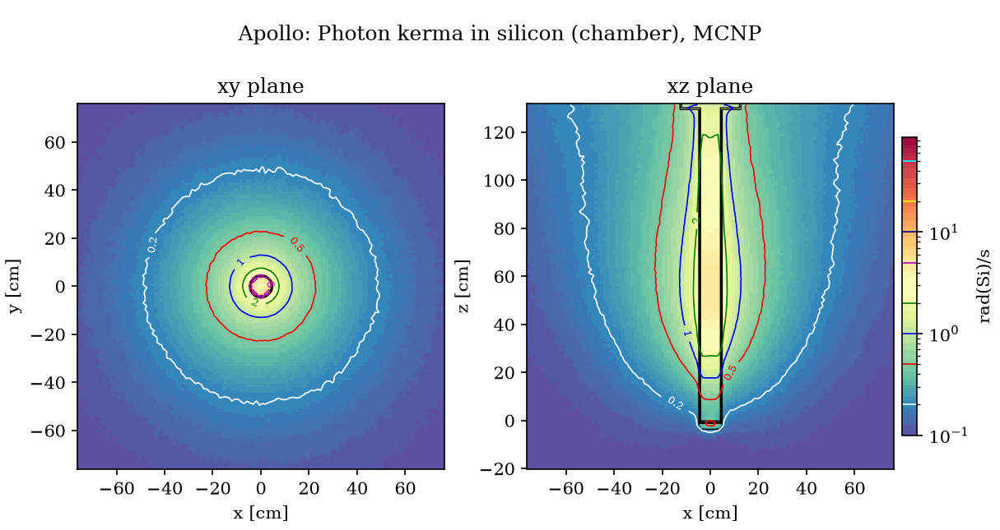

`plot_results.py --system apollo` also maps the neutron flux in the other energy groups, the
photon flux, the neutron and total kerma, and the hardness factor, for both codes, around the
chamber and over the whole main room.

## Limitations

Besides those every model shares (see [Methods](methods.md#limitations)): the irradiation rooms
are empty, and the model leaves out the accelerator, the internal structure of the beam stop, and
anything placed around the chamber. Parts and fixtures near the chamber change the field around
them.
