# Artemis

Artemis is SHINE's neutron generator for SHINE Radiation Effects. It makes neutrons with a
280 keV, 45 mA deuteron beam (12.6 kW) traveling down a 137 cm target chamber of deuterium-tritium
gas (50% D₂, 50% T₂). The chamber sits in a water pit below ground, with an irradiation cavity on
each side of it. Parts to be irradiated go in a cassette in each cavity, as close to the chamber as
the cavity wall allows.

[Back to the README](../README.md) · [Methods](methods.md) · [Apollo](apollo.md)

## Contents

- [The model](#the-model)
- [The source](#the-source)
- [Results](#results)
- [Limitations](#limitations)

## The model

A very simplified model of Artemis below ground, in
[`mcnp/artemis/artemis.i`](../mcnp/artemis/artemis.i) and
[`openmc/artemis/artemis.py`](../openmc/artemis/artemis.py):

- the target chamber, with its double steel wall and cooling water, and the beam stop at its
  bottom;
- the upstream section of the beamline, with the beam tube up to the ground;
- the two irradiation cavities (aluminum), each with its cassette region and its duct up to the
  ground, and the water and aluminum wall between the chamber and each cavity (their cylinders
  centered 0.48 cm toward the cavity, as in the design);
- the water pit, full of water up to the ground, its steel liner, and an air gap;
- the concrete pit walls, floor, and slab; 3 ft of earth around them; and air above ground.

The model is symmetric about x = 0 and y = 0. The backstop is at the origin, the beam travels
down (−z), and the ground is at z = 289.56 cm. Every cell is a plain intersection of
half-spaces, so the model is easy to read and runs fast.

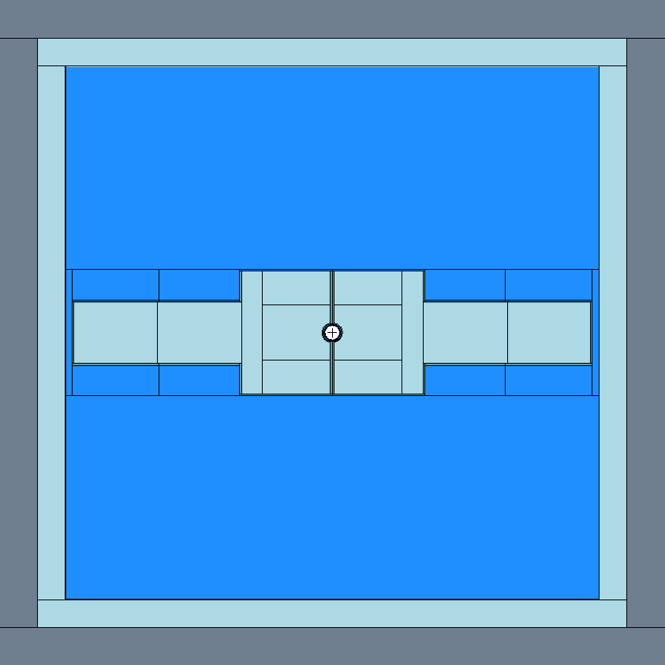
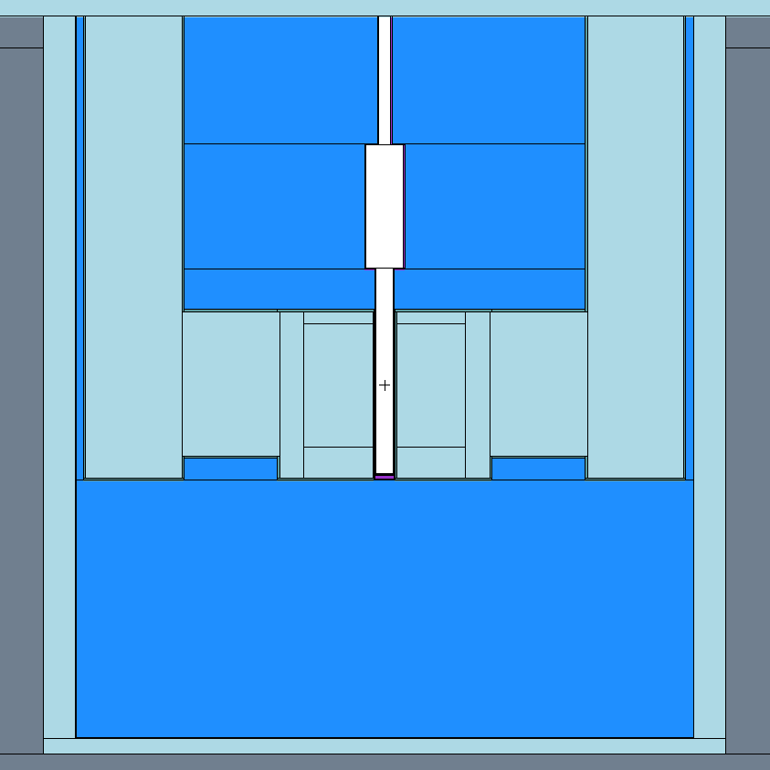

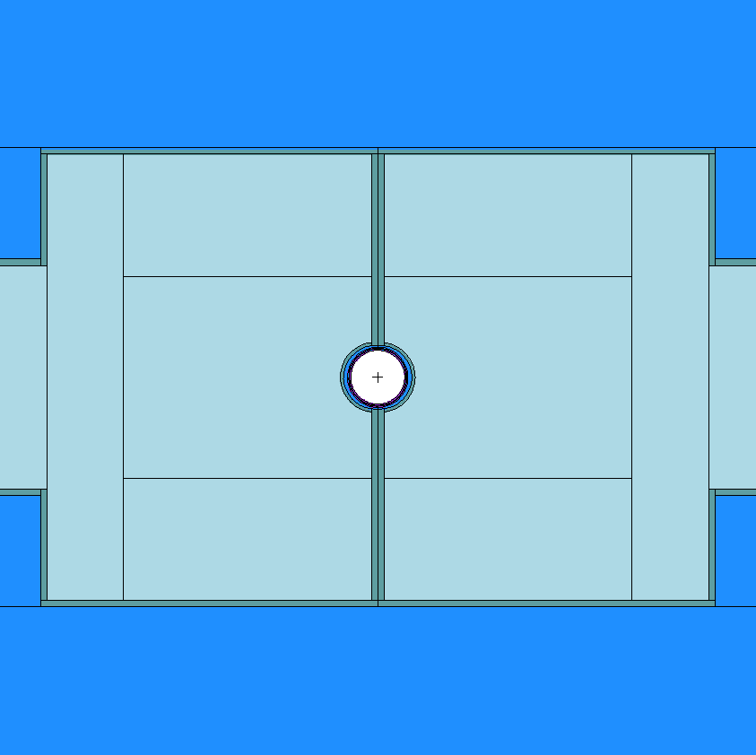
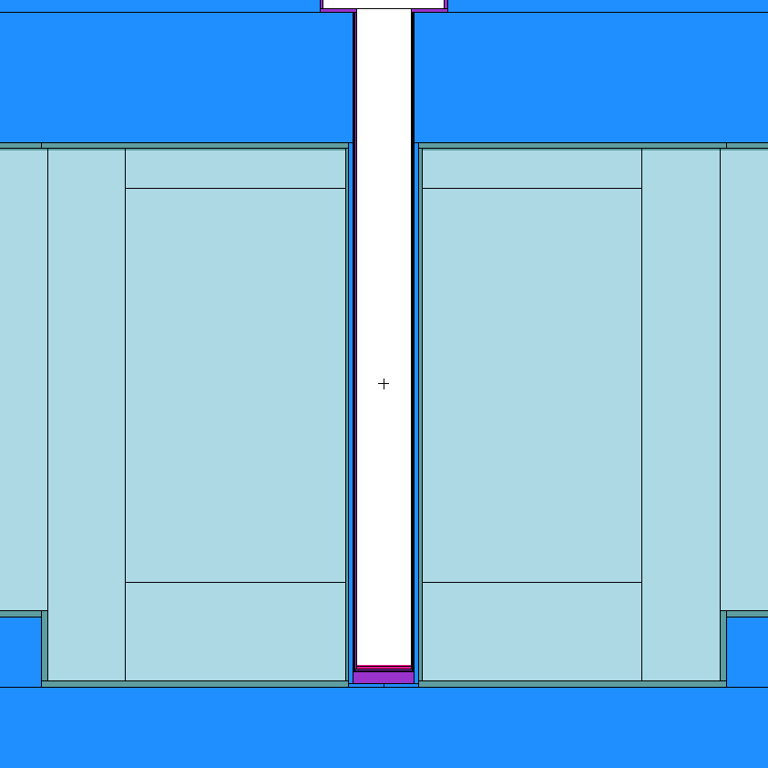

**The cassette regions** (cells 106 and 206) are the space available for parts: a box 49.9 cm long (along x), 40.6 cm wide, and 78.1 cm high (z = 16.5 to
94.6 cm), outside the cavity wall around the chamber. Each holds 153.2 liters of air. The maps
outline their open sides with dashed gray lines.

**The peak** is on a 5 × 5 cm plate, 0.1 cm thick, 7.8 to 7.9 cm from the beam axis in each
cassette region (about as close to the chamber as a part in the cassette can get), at the height
of the peak flux (z = 55.88 cm).

**Materials** come from PNNL's *Compendium of Material Composition Data for Radiation Transport
Modeling*, with ENDF/B-VIII.1 data: air, aluminum 6061-O, Portland concrete, copper, U.S. average
earth, stainless steel 304, and water, with thermal scattering data for aluminum, iron, and
hydrogen in water.

**Tallies** follow the numbering shared by every system (see [Methods](methods.md#tallies)):

| Tallies | What |
|---|---|
| 124, 134 | Neutron spectrum (CCFE-709 groups) and photon spectrum (VITAMIN-J-42) in the cassette regions (in the models, not in the results below) |
| 144, 154, 164 | 1-MeV(Si) equivalent neutron flux, neutron kerma in silicon, and photon kerma in silicon, in the cassette regions (likewise) |
| 214 to 264, 314 to 364 | At the peak in the −x and +x cassette regions: the neutron flux in four energy groups, the neutron and photon spectra, and the three responses in silicon |
| 4w4 to 8w4 | Maps of each quantity in each plot window w: 1 and 2 for the xy and xz pit plots, 4 and 5 for the cavity plots |

## The source

The source comes from [beam-target](https://github.com/lucasjacobson/beam-target), which follows
the deuteron beam down the chamber as it slows down and spreads, and calculates the neutrons it
makes at each position, angle, and energy. The gas density is solved so that the beam reaches the
backstop with 10 keV. The input is [`source/artemis.toml`](../source/artemis.toml), and the full
summary is in [`source/Artemis/summary.toml`](../source/Artemis/summary.toml).

| | |
|---|---|
| Beam | Deuterons, 280 keV, 45 mA, 0.4 cm diameter at entry, 36 mrad divergence |
| Target | D₂/T₂ gas (50/50), 137 cm long, 10.90 cm (4.29 in) inner diameter, 1.47 × 10⁻⁶ g/cm³ (solved) |
| Stopping powers | ICRU Report 49 |
| Cross sections | DROSG-2000: T(d,n)⁴He and D(d,n)³He |
| Neutron yield | 1.749 × 10¹³ n/s: 99.0% DT, 1.0% DD |
| Mean neutron energy | 14.00 MeV: 14.11 MeV from DT, 2.55 MeV from DD |

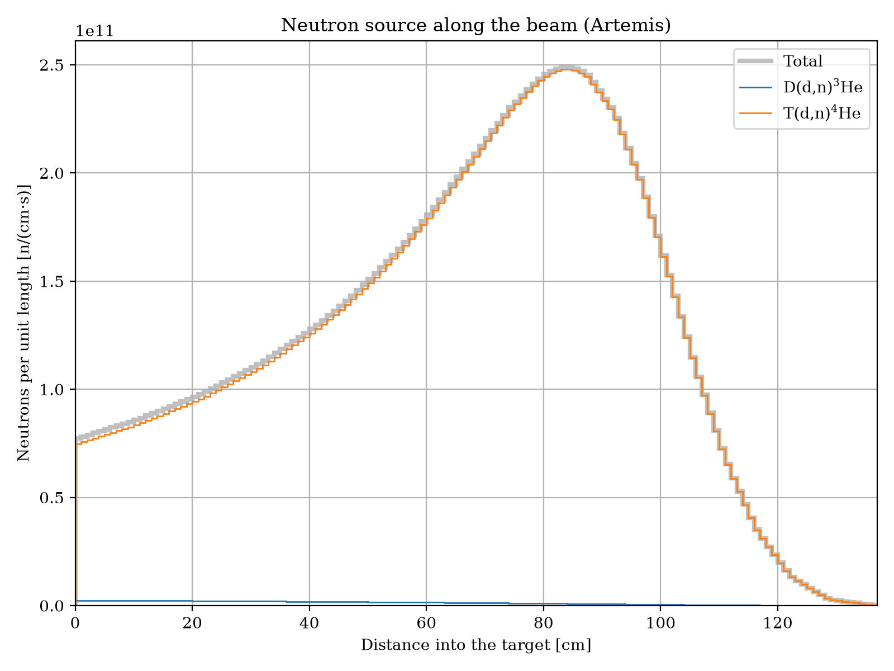
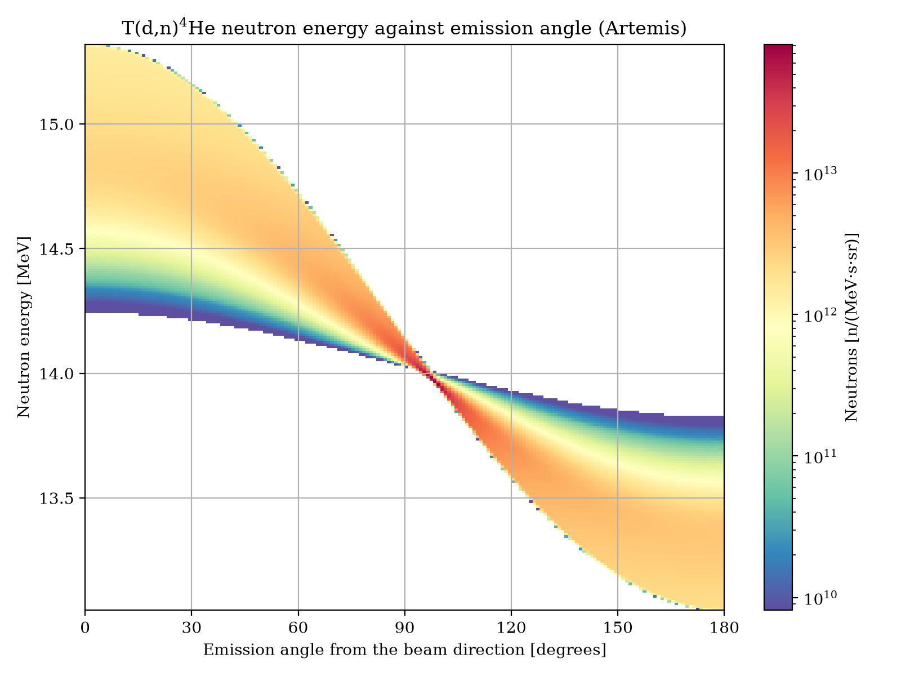

## Results

From 10⁸ histories in each code, per second at the full yield, at the peak: on the
5 × 5 × 0.1 cm plates. The two plates (−x and +x) agree within statistics, so each value is the
mean of the two. The values are from MCNP, with their relative errors (one standard deviation,
statistical; for the total kerma and the two ratios they are combined as if independent, which
overstates them for the ratios), and OpenMC's as a ratio to MCNP's.

| At the peak | MCNP | OpenMC/MCNP |
|---|---|---|
| Neutron flux [n/cm²-s] | 6.79 × 10⁹ (0.10%) | 1.001 |
| Neutron flux above 10 MeV [n/cm²-s] | 4.92 × 10⁹ (0.11%) | 1.006 |
| 1-MeV(Si) equivalent flux [n/cm²-s] | 1.08 × 10¹⁰ (0.10%) | 1.002 |
| Neutron kerma in silicon [rad(Si)/s] | 6.28 (0.10%) | 1.006 |
| Photon kerma in silicon [rad(Si)/s] | 1.99 (0.25%) | 1.082 |
| Total kerma in silicon [rad(Si)/s] | 8.27 (0.10%) | 1.025 |
| Hardness factor (1-MeV(Si) equivalent / total) | 1.60 (0.14%) | 1.001 |
| Fraction of the neutron flux above 10 MeV | 0.724 (0.14%) | 1.005 |

The photon kerma is 8% higher in OpenMC; see [MCNP and OpenMC](methods.md#mcnp-and-openmc).

### Spectra

At the peak, the mean of the two plates.

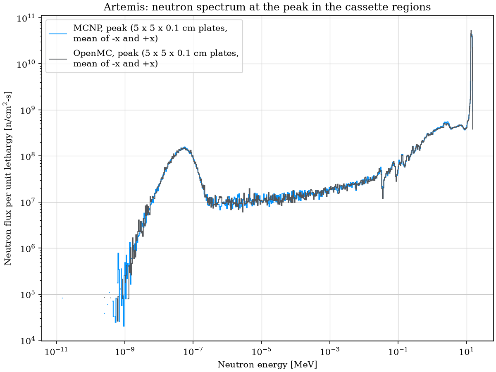
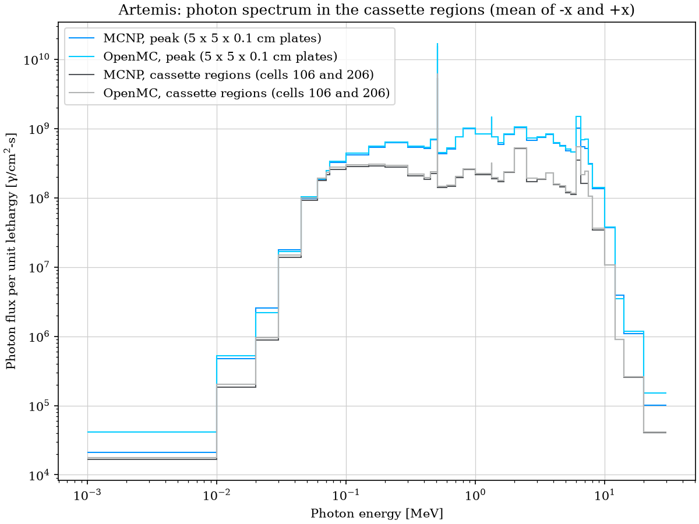

### Maps

In the cavities, from MCNP: the neutron flux, the neutron flux above 10 MeV, the 1-MeV(Si)
equivalent neutron flux, the fraction of the neutron flux above 10 MeV, and the photon kerma in
silicon.

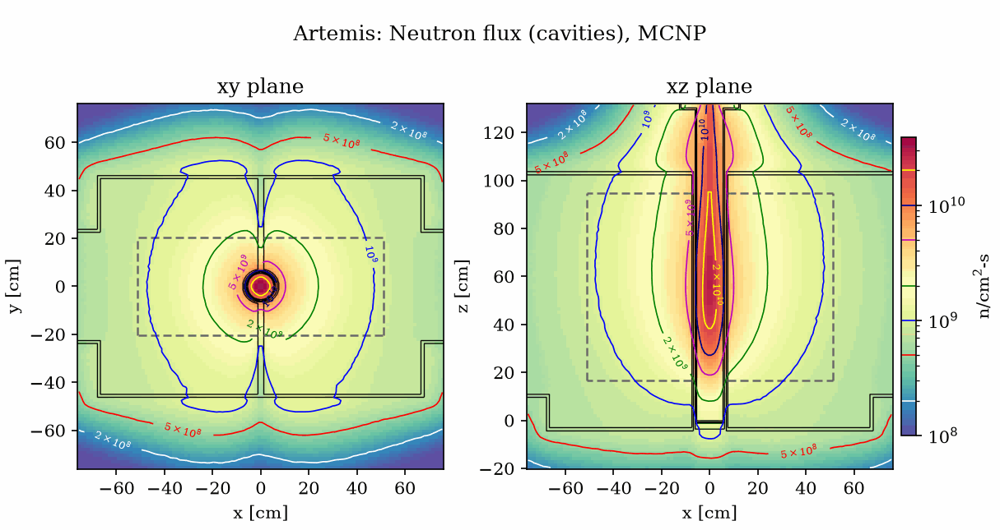

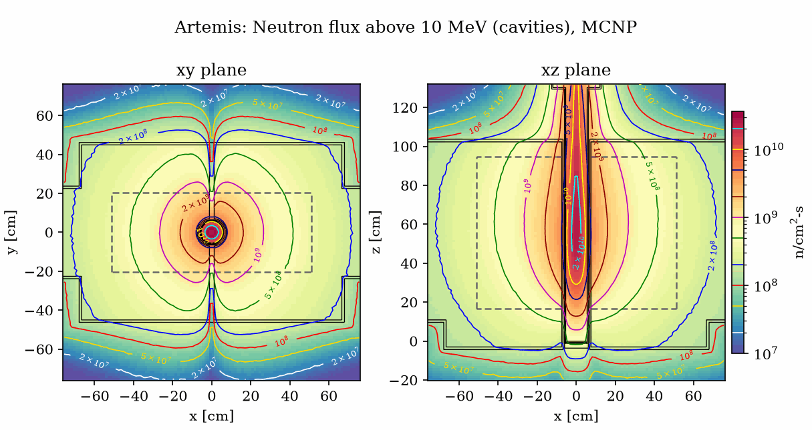

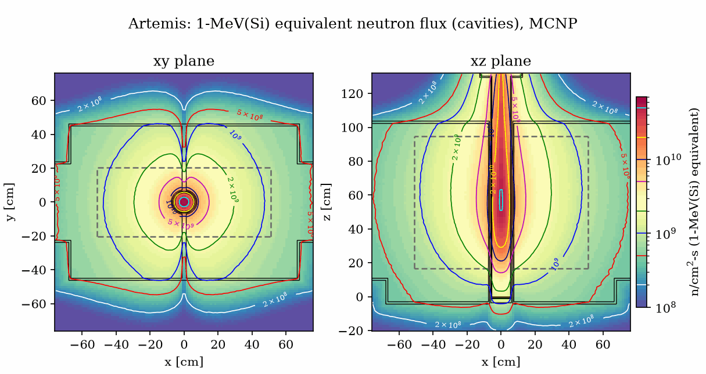

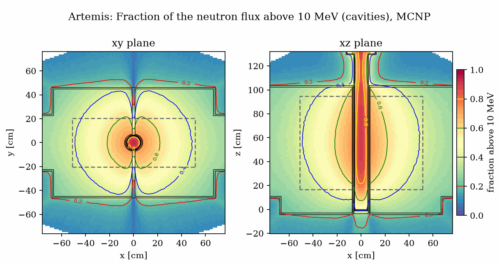

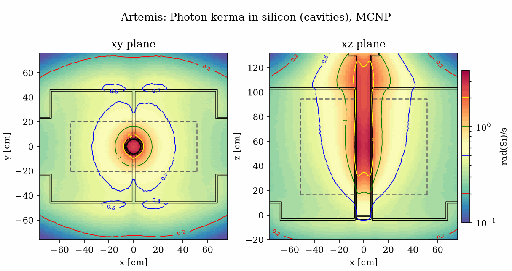

`plot_results.py --system artemis` also maps the neutron flux in the other energy groups, the
photon flux, the neutron and total kerma, and the hardness factor, for both codes, in the cavities
and over the whole pit.

## Limitations

Besides those every model shares (see [Methods](methods.md#limitations)): the model leaves out
the accelerator, the internal structure of the beam stop, the building above ground, and anything
in the cassette regions, which are empty. Parts in a cassette change the field around them.
